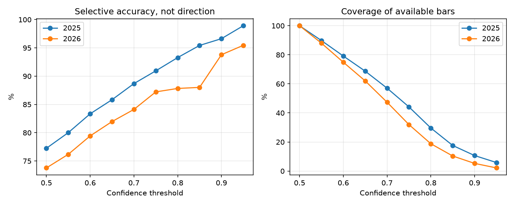

# Intraday volatility regime research

Can prior-day VXN and completed-bar features classify whether the next MNQ bar's high-low range will exceed a frozen forecast?

This project separates **numeric range forecasting**, **binary expansion classification**, and **trading profitability**. These are different problems. No direction forecast is implied.

## Method
- Numeric scale: `open × prior_VXN / sqrt(252) × sqrt(minutes/390) / 100`, multiplied by a training-period time-bucket calibration factor.
- Session definition: 16:00–21:00 Europe/Rome; US daylight-saving mismatch weeks matter.
- Logistic regression: median imputation, standardization, C=0.25, balanced class weights; 29 completed-bar features including range ratios, wick/body measures, lagged expansion and session state.
- Local chronology rebuild uses stable tick ordering. Historical 15-minute model trained on 2024, evaluated separately on 2025/2026.
- Selective confidence: expansion p≥0.70, contraction p≤0.30. Coverage must be reported beside accuracy.
- Five-minute reversal experiments are a separate model/strategy and are not interchangeable with the 15-minute classification results.

## Historical findings — provisional
| Evaluation | All bars | Selective signals | Coverage | Selective accuracy | Expansion precision | Contraction precision |
|---|---:|---:|---:|---:|---:|---:|
| 2025 | 4,725 | 2,695 | 57.04% | 88.68% | 88.53% | 88.85% |
| 2026 available subset | 3,058 | 1,448 | 47.35% | 84.12% | 79.79% | 88.86% |

These are reconstructed stored predictions, **not a new training run**. The 2026 sample has 161 numeric-range sessions, not a complete year. Median absolute numeric error was 16.89 MNQ points in 2025 and 20.37 in 2026; these values are not mean absolute error. High classification precision does not mean precise price levels.

## Reproduce the public checks
```bash
python -m pip install -r requirements.txt
python evaluate.py
python -m unittest discover -s tests -v
```
The evaluator recomputes classification metrics from the published prediction-level CSV, writes results and a confidence/coverage chart to `generated/`. No raw market feed is bundled.

## Research lineage
`archive/` preserves the actual research implementations: chronology reconstruction, feature engineering, confidence sweeps and walk-forward checks. Those scripts refer to the original local research layout and private tick/event caches; they are **not turnkey data-download pipelines**. See provenance and limitations before using them.

## Evidence, not performance promises


See [recomputed accuracy](reports/recomputed_accuracy.csv), [confidence curve](reports/confidence_curve.csv) and [data dictionary](docs/reproduction.md).

See [data provenance and limitations](docs/provenance.md). Results are backtests, not audited live returns. The public runnable commands reproduce derived-output analytics or synthetic checks, not the entire licensed-data research process.
